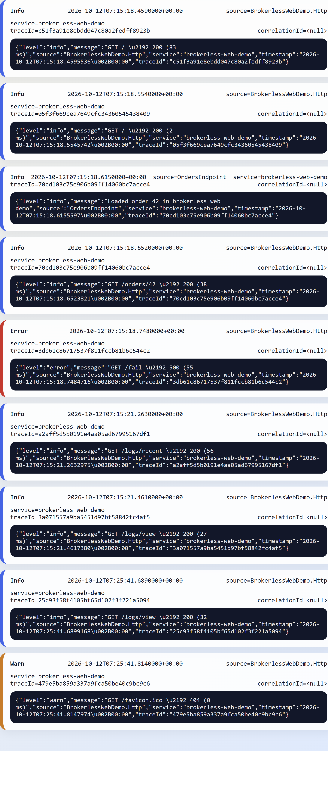

# HobiaryLogPipe

**Portfolio preview: .NET 10 logging pipeline backed by a custom C11 engine.**
Start with the brokerless demos below: no RabbitMQ, credentials or private
infrastructure are needed. This is an experimental project, not a claim of
production readiness.

## Portfolio demo: write logs, then see them in your browser

Requirements: .NET 10 SDK, CMake 3.20+, Ninja and a C compiler (MinGW UCRT64 on
Windows). Clone the repositories into sibling directories:

```sh
git clone https://github.com/andrzejskutnik/hobiary-logdb.git
git clone https://github.com/andrzejskutnik/hobiary-logpipe.git
cd hobiary-logdb
git checkout --detach a5cc79e82f18e5b718c48e62b47f8962c529bdbe
cmake -S . -B build -G Ninja -DCMAKE_BUILD_TYPE=Release
cmake --build build
cd ../hobiary-logpipe
dotnet build HobiaryLogPipe.slnx
dotnet run --project samples/BrokerlessDemo/BrokerlessDemo.csproj -- --hold-seconds 1
```

The console demo persists synthetic Info/Warn/Error messages and reads them
back from `.hlog` files. For the web demo, run:

```sh
dotnet run --project samples/BrokerlessWebDemo/BrokerlessWebDemo.csproj
```

Open these URLs in order:

1. <http://localhost:5088/orders/42> — writes a sample business event.
2. <http://localhost:5088/fail> — intentionally returns HTTP 500 to demonstrate error logging.
3. <http://localhost:5088/logs/view?limit=20&minutes=30> — rendered log cards.
4. <http://localhost:5088/logs/recent?limit=20&minutes=30> — the same records as JSON.

<details>
<summary>Actual demo output: order event and HTTP 500 captured in native storage</summary>



</details>

On Windows with PowerShell 7, one command builds traffic, runs both demos and
checks readback:

```powershell
pwsh -File .\tools\start-brokerless-demos.ps1 -StopWebOnExit
```

Omit `-StopWebOnExit` only if you want to keep the browser demo running.
The launcher clears only the selected sample plugin output directories; do not
point it at real logs. Demo endpoints bind to localhost and are not a hosted
production service.

### What to look for

- Native C storage invoked from .NET via P/Invoke.
- Structured logs through `ILogger` and direct `ILogPipeWriter`.
- HTTP middleware capturing requests and synthetic failures.
- Reopen/readback, a browser view and JSON output without a broker.
- RabbitMQ transport, Serilog and OpenTelemetry integrations are separate
  features; the brokerless demo does not prove RabbitMQ delivery guarantees.

CI pins the native engine to a public commit rather than a private checkout.
The native library is copied automatically from `../hobiary-logdb/build`.
For a different build directory, pass
`-p:HobiaryLogDbBuildDir=<absolute-directory-with-trailing-separator>` to
`dotnet build`/`dotnet run`. A fresh clone must build this dependency first.
When running the test suite with a custom directory, set the
`HobiaryLogDbBuildDir` environment variable as well: CLI integration tests
launch child builds that inherit environment variables, not MSBuild command
line properties.

Licensed under [Apache-2.0](LICENSE).
Related projects: [HobiaryLogDB](https://github.com/andrzejskutnik/hobiary-logdb),
[HobiaryDB](https://github.com/andrzejskutnik/hobiarydb) and
[JDBC/DBeaver driver](https://github.com/andrzejskutnik/dbeaver-driver-hobiarydb).

---

Dynamiczny pipeline logów: aplikacje rejestrują się jako pluginy, przesyłają logi przez **RabbitMQ**, adapter persystuje je w **[HobiaryLogDB](../hobiary-logdb)** (pliki `.hlog`).

```
App [InputPlugin] ──AMQP──► RabbitMQ ──► Adapter ──► HobiaryLogDB (.hlog)
```

Dostępny jest też wariant bez brokera komunikatów: `InputPlugin` może pracować w trybie `Direct` i zapisywać logi bezpośrednio do lokalnego katalogu HobiaryLogDB, z pominięciem RabbitMQ i Adaptera.

## Spis treści

- [HobiaryLogPipe](#hobiarylogpipe)
  - [Wymagania](#wymagania)
  - [Szybki start](#szybki-start)
    - [1. Skonfiguruj RabbitMQ](#1-skonfiguruj-rabbitmq)
    - [2. Uruchom Adapter](#2-uruchom-adapter)
    - [3. Dodaj plugin do aplikacji](#3-dodaj-plugin-do-aplikacji)
    - [3a. Wariant bez brokera (`Direct`)](#3a-wariant-bez-brokera-direct)
    - [3b. Brokerless Quick Start](#3b-brokerless-quick-start)
    - [4. Lokalny smoke flow](#4-lokalny-smoke-flow)
    - [5. Runbook `Direct` krok po kroku](#5-runbook-direct-krok-po-kroku)
    - 6. Mini troubleshooting `hobiarylogdb.dll` / `libhobiarylogdb.so`
  - [Konfiguracja](#konfiguracja)
  - [Jak dodać plugin do aplikacji](#jak-dodać-plugin-do-aplikacji)
  - [REST API adaptera](#rest-api-adaptera)
  - [Build i testy](#build-i-testy)
  - [Dokumentacja](#dokumentacja)

---

## Wymagania

- .NET 10 SDK
- RabbitMQ 3.12+ dla wariantu `RabbitMq`
- `hobiarylogdb.dll` / `libhobiarylogdb.so` dla wariantu `Direct`

Jeżeli budujesz bibliotekę natywną lokalnie, znajdziesz ją w repo `hobiary-logdb` jako `build/hobiarylogdb.dll` (Windows) albo `build/libhobiarylogdb.so` (Linux).

---

## Szybki start

### 1. Skonfiguruj RabbitMQ

```bash
# Utwórz VHost i exchange'e
rabbitmqctl add_vhost /hobiary
rabbitmqctl add_user hobiary-adapter SILNE_HASLO
rabbitmqctl set_permissions -p /hobiary hobiary-adapter ".*" ".*" ".*"

rabbitmqadmin -V /hobiary declare exchange name=hobiary.announce type=fanout durable=true
rabbitmqadmin -V /hobiary declare exchange name=hobiary.data type=direct durable=true
rabbitmqadmin -V /hobiary declare queue name=hobiary.unknown durable=true
```

### 2. Uruchom Adapter

```bash
cd src/HobiaryLogPipe.Adapter
# Skopiuj config/appsettings.example.json → appsettings.json i wypełnij
dotnet run
```

### 3. Dodaj plugin do aplikacji

```csharp
builder.Services.AddHobiaryLogPipe(opt =>
{
    opt.PluginId  = "orders-service";
    opt.Host      = "localhost";
    opt.Username  = "orders-user";
    opt.Password  = "haslo";
});
```

Logi trafiają do `{BaseLogDirectory}/orders-service/hlog_*.hlog`.

### 3a. Wariant bez brokera (`Direct`)

Jeżeli nie chcesz używać RabbitMQ ani uruchamiać Adaptera, ustaw transport bezpośredni:

```csharp
builder.Services.AddHobiaryLogPipe(opt =>
{
  opt.Transport = LogPipeTransport.Direct;
  opt.PluginId = "orders-service";
  opt.BaseLogDirectory = "logs-direct";
});
```

W tym trybie `InputPlugin` tworzy katalog `{BaseLogDirectory}/{PluginId}` i zapisuje rekordy od razu do HobiaryLogDB. Wymagane jest jedynie lokalne `hobiarylogdb.dll` lub `libhobiarylogdb.so` dostępne w output projektu.

Brokerless readback dla sample i testów korzysta teraz ze wspólnej biblioteki `HobiaryLogPipe.HobiaryLog`, więc nie wymaga już referencji do całego projektu Adaptera tylko po to, żeby odczytać `.hlog`.

### 3b. Brokerless Quick Start

Najkrótszy przebieg bez RabbitMQ i bez Adaptera wygląda tak:

1. Upewnij się, że `hobiarylogdb.dll` albo `libhobiarylogdb.so` jest dostępne w output projektu .NET.
2. Uruchom launcher demo:

```powershell
pwsh -File .\tools\start-brokerless-demos.ps1 -StopWebOnExit
```

3. Otwórz widok HTML z ostatnimi logami:

```text
http://localhost:5088/logs/view?limit=20&minutes=30
```

4. Sprawdź, że powstały świeże pliki `.hlog`:

```text
samples/
  BrokerlessDemo/
    demo-logs/
      brokerless-demo/
  BrokerlessWebDemo/
    demo-logs/
      brokerless-web-demo/
```

Launcher uruchamia web demo, wykonuje przykładowe requesty HTTP, startuje `BrokerlessDemo`, pokazuje demo-focused readback z `.hlog` i automatycznie zamyka web demo, jeżeli używasz `-StopWebOnExit`.

Przykładowy oczekiwany output launchera:

```text
BrokerlessWebDemo is running under PID 40696.
Invoking sample HTTP requests...
GET /fail -> HTTP 500
Running console brokerless demo...
Read back 8 record(s) from '.\samples\BrokerlessDemo\demo-logs\brokerless-demo'. Displaying 4 demo-focused record(s):
- [Info] source=BrokerlessDemoWorker service=<null>
  message=Brokerless demo started for brokerless-demo
- [Warn] source=BrokerlessDemoWorker service=<null>
  message=This warning is written through Microsoft.Extensions.Logging provider.
- [Info] source=BrokerlessDemoWorker service=brokerless-demo
  message=Direct write through ILogPipeWriter
- [Error] source=BrokerlessDemoWorker service=brokerless-demo
  message=Simulated business error stored without broker
HTML view: http://localhost:5088/logs/view?limit=20&minutes=30
BrokerlessWebDemo stopped automatically.
```

### 4. Lokalny smoke flow

Najkrótszy lokalny przebieg, który został już zweryfikowany end-to-end, używa:

- `src/HobiaryLogPipe.Adapter/appsettings.Development.json`,
- `Urls = "http://localhost:5050"`,
- `HobiaryLogPipe.AllowedPlugins = ["orders-service"]`,
- `HobiaryLogPipe.BaseLogDirectory = "logs-dev"`,
- `HobiaryLogPipe.HttpApiKey` przekazany przez `HobiaryLogPipe__HttpApiKey`,
- `RabbitMQ.Host = "localhost"`,
- `RabbitMQ.Port = 5672`.

Uruchom Adapter:

```powershell
dotnet run --project .\src\HobiaryLogPipe.Adapter
```

Wyślij jeden log testowy przez minimalny publisher:

```powershell
dotnet run --project .\samples\SmokePublisher\SmokePublisher.csproj
```

Publisher domyślnie publikuje dla `orders-service`, czeka chwilę po `announce`, wysyła jeden log i utrzymuje rejestrację przez krótkie okno testowe, żeby smoke test zdążył zobaczyć aktywny plugin.

Jeżeli chcesz sprawdzić Adapter na realnym producencie zamiast minimalnego sample, możesz użyć też `DemoApp`, który przechodzi przez integracje `Serilog`, `MicrosoftLogging` i `OpenTelemetry`:

```powershell
$env:DOTNET_ENVIRONMENT = 'Development'
$env:HobiaryLogPipe__AllowedPlugins__0 = 'orders-service'
$env:HobiaryLogPipe__AllowedPlugins__1 = 'demo-serilog'
$env:HobiaryLogPipe__AllowedPlugins__2 = 'demo-mel'
$env:HobiaryLogPipe__AllowedPlugins__3 = 'demo-otel'
dotnet run --project .\src\HobiaryLogPipe.Adapter
```

W drugim terminalu:

```powershell
$env:HOBIARY_HOLD_SECONDS = '20'
dotnet run --project .\samples\DemoApp\DemoApp.csproj
```

W tym wariancie smoke test najwygodniej uruchamiać dla `demo-mel`:

```powershell
pwsh -File .\tools\platform-demo-smoke.ps1 \
  -ApiBaseUrl "http://localhost:5050" \
  -PluginId "demo-mel" \
  -ApiKey "$env:HobiaryLogPipe__HttpApiKey" \
  -LogDirectory ".\src\HobiaryLogPipe.Adapter\logs-dev"
```

Na końcu uruchom smoke test:

```powershell
pwsh -File .\tools\platform-demo-smoke.ps1 \
  -ApiBaseUrl "http://localhost:5050" \
  -PluginId "orders-service" \
  -ApiKey "$env:HobiaryLogPipe__HttpApiKey" \
  -LogDirectory ".\src\HobiaryLogPipe.Adapter\logs-dev"
```

Skrypt obsługuje rzeczywisty układ runtime `logs-dev/orders-service/*.hlog`, więc parametr `LogDirectory` powinien wskazywać katalog bazowy.

Pełny opis obu wariantów lokalnego workflow jest też w portalu dokumentacji: `hobiary-docs/docs/tutorials/logpipe-local-dev-runbook.md`.

Jeżeli równolegle pracujesz nad portalem dokumentacyjnym, podstawową walidację docs/tools uruchomisz w repo `hobiary-docs` poleceniem `pwsh -File .\tools\validate-docs.ps1`.

### 5. Runbook `Direct` krok po kroku

To jest najprostszy przebieg lokalny bez RabbitMQ i bez Adaptera.

Założenia:

- `hobiarylogdb.dll` lub `libhobiarylogdb.so` jest dostępne w output projektu,
- chcesz zapisać logi lokalnie do katalogu roboczego,
- wystarczy Ci zapis do `.hlog`, bez dashboardu, REST API i allowlisty pluginów.

Uruchom minimalny sample brokerless:

```powershell
$env:HOBIARY_PLUGIN_ID = 'orders-service'
$env:HOBIARY_DIRECT_LOG_DIR = '.\logs-direct'
dotnet run --project .\samples\DirectPublisher\DirectPublisher.csproj
```

Po wykonaniu polecenia powinien powstać katalog:

```text
logs-direct/
  orders-service/
    hlog_000001.hlog
    hlog_000001.hidx_time
    hlog_000001.hidx_error
    hlog_000001.hidx_level
    hlog_000001.hidx_src
```

Jeżeli chcesz użyć istniejącego `SmokePublisher`, możesz przełączyć go na `Direct` przez zmienną środowiskową:

```powershell
$env:HOBIARY_TRANSPORT = 'Direct'
$env:HOBIARY_PLUGIN_ID = 'orders-service'
$env:HOBIARY_DIRECT_LOG_DIR = '.\logs-direct'
dotnet run --project .\samples\SmokePublisher\SmokePublisher.csproj
```

Jeżeli chcesz przejść przez pełniejsze integracje (`Serilog`, `MicrosoftLogging`, `OpenTelemetry`) bez brokera, uruchom `DemoApp` w tym samym trybie:

```powershell
$env:HOBIARY_TRANSPORT = 'Direct'
$env:HOBIARY_DIRECT_LOG_DIR = '.\logs-direct-demo'
$env:HOBIARY_SERILOG_PLUGIN_ID = 'demo-serilog'
$env:HOBIARY_MEL_PLUGIN_ID = 'demo-mel'
$env:HOBIARY_OTEL_PLUGIN_ID = 'demo-otel'
dotnet run --project .\samples\DemoApp\DemoApp.csproj
```

W tym wariancie każdy plugin zapisze osobny katalog pod `logs-direct-demo`.

Ograniczenia trybu `Direct`:

- nie ma RabbitMQ, więc nie ma `announce`, `heartbeat`, `dead-letter`, retry ani kolejek,
- nie działa Adapter, więc nie ma `/dashboard`, `/api/*`, `/metrics` ani SSE,
- filtracja, allowlista i polityki bezpieczeństwa z Adaptera nie są wykonywane,
- odpowiedzialność za lokalizację katalogu logów przechodzi na proces używający `InputPlugin`.

Jeżeli chcesz bardziej kompletne demo tego wariantu, uruchom dedykowany sample:

```powershell
$env:HOBIARY_PLUGIN_ID = 'brokerless-demo'
$env:HOBIARY_DIRECT_LOG_DIR = '.\samples\BrokerlessDemo\demo-logs'
dotnet run --project .\samples\BrokerlessDemo\BrokerlessDemo.csproj
```

Ten sample pokazuje rejestrację `HobiaryLogPipe` w DI, zapis przez `ILogger` i `ILogPipeWriter`, a potem odczyt wygenerowanych rekordów z `.hlog` na konsoli.

Jeżeli chcesz lokalnie obejrzeć albo wyeksportować rekordy bez uruchamiania web demo, użyj `HlogInspect`:

```powershell
dotnet run --project .\samples\HlogInspect\HlogInspect.csproj -- \
  --base-dir .\samples\BrokerlessDemo\demo-logs \
  --plugin-id brokerless-demo \
  --minutes 30 \
  --limit 20 \
  --format table
```

Filtrowanie po `source` albo `service`:

```powershell
dotnet run --project .\samples\HlogInspect\HlogInspect.csproj -- \
  --base-dir .\samples\BrokerlessDemo\demo-logs \
  --plugin-id brokerless-demo \
  --source OrdersService \
  --service api-gateway \
  --format json
```

Filtrowanie po `traceId`:

```powershell
dotnet run --project .\samples\HlogInspect\HlogInspect.csproj -- \
  --base-dir .\samples\BrokerlessDemo\demo-logs \
  --plugin-id brokerless-demo \
  --traceId 0123456789abcdef0123456789abcdef \
  --format json
```

Jeżeli analizujesz kilka śladów naraz, `--traceId` przyjmuje też listę rozdzieloną przecinkami:

```powershell
dotnet run --project .\samples\HlogInspect\HlogInspect.csproj -- \
  --base-dir .\samples\BrokerlessDemo\demo-logs \
  --plugin-id brokerless-demo \
  --traceId 0123456789abcdef0123456789abcdef,fedcba9876543210fedcba9876543210 \
  --format json
```

`--traceId` akceptuje wyłącznie tokeny w formacie 32-znakowego hex. Błędny token kończy się błędem parsera przed uruchomieniem zapytania.

Jeżeli wolisz bardziej shellowy zapis flag, możesz użyć aliasu `--trace-id`.

Filtrowanie po `correlationId`:

```powershell
dotnet run --project .\samples\HlogInspect\HlogInspect.csproj -- \
  --base-dir .\samples\BrokerlessDemo\demo-logs \
  --plugin-id brokerless-demo \
  --correlationId aabbccddeeff00112233445566778899 \
  --format json
```

Tak samo `--correlationId` może zawierać kilka identyfikatorów oddzielonych przecinkami, gdy chcesz złożyć widok dla wielu powiązanych przepływów:

```powershell
dotnet run --project .\samples\HlogInspect\HlogInspect.csproj -- \
  --base-dir .\samples\BrokerlessDemo\demo-logs \
  --plugin-id brokerless-demo \
  --correlationId aabbccddeeff00112233445566778899,99887766554433221100ffeeddccbbaa \
  --format json
```

`--correlationId` akceptuje 32-znakowy hex albo GUID. Jeżeli podasz GUID, CLI znormalizuje go do formatu bez myślników zanim zastosuje filtr.

CLI akceptuje też alias `--correlation-id`, równoważny `--correlationId`.

Filtrowanie po fragmencie `message` albo surowego `payload`:

```powershell
dotnet run --project .\samples\HlogInspect\HlogInspect.csproj -- \
  --base-dir .\samples\BrokerlessDemo\demo-logs \
  --plugin-id brokerless-demo \
  --contains timeout \
  --format json
```

Domyślnie `--contains` sprawdza jednocześnie `message` i `payloadJson`. Jeżeli chcesz ograniczyć wyszukiwanie do jednego pola, dodaj `--contains-field any|message|payload`:

```powershell
dotnet run --project .\samples\HlogInspect\HlogInspect.csproj -- \
  --base-dir .\samples\BrokerlessDemo\demo-logs \
  --plugin-id brokerless-demo \
  --contains timeout \
  --contains-field payload \
  --format json
```

Jeżeli `--contains` ma przyjąć kilka tokenów rozdzielonych przecinkami, możesz sterować semantyką dopasowania przez `--contains-mode any|all`. `any` zwraca rekord, gdy pasuje dowolny token, a `all` wymaga dopasowania wszystkich tokenów w wybranym polu lub polach:

```powershell
dotnet run --project .\samples\HlogInspect\HlogInspect.csproj -- \
  --base-dir .\samples\BrokerlessDemo\demo-logs \
  --plugin-id brokerless-demo \
  --contains timeout,orders \
  --contains-field message \
  --contains-mode all \
  --format json
```

Jeżeli chcesz zawęzić wynik do kilku konkretnych producerów albo kanałów wykonania, `--source` i `--service` przyjmują listy rozdzielone przecinkami i dopasowują rekord, gdy wartość pola pasuje do któregokolwiek tokenu:

```powershell
dotnet run --project .\samples\HlogInspect\HlogInspect.csproj -- \
  --base-dir .\samples\BrokerlessDemo\demo-logs \
  --plugin-id brokerless-demo \
  --source OrdersService,BillingService \
  --service api-gateway,worker \
  --format json
```

`--level` nadal działa jako filtr minimalnego poziomu (`>=`), a gdy potrzebujesz dokładnego zestawu poziomów po stronie CLI, użyj `--level-in`:

```powershell
dotnet run --project .\samples\HlogInspect\HlogInspect.csproj -- \
  --base-dir .\samples\BrokerlessDemo\demo-logs \
  --plugin-id brokerless-demo \
  --level-in Info,Error \
  --format json
```

Sortowanie od najnowszych rekordów:

```powershell
dotnet run --project .\samples\HlogInspect\HlogInspect.csproj -- \
  --base-dir .\samples\BrokerlessDemo\demo-logs \
  --plugin-id brokerless-demo \
  --sort desc \
  --format table
```

Prosta paginacja przez `offset`:

```powershell
dotnet run --project .\samples\HlogInspect\HlogInspect.csproj -- \
  --base-dir .\samples\BrokerlessDemo\demo-logs \
  --plugin-id brokerless-demo \
  --sort desc \
  --offset 20 \
  --limit 20 \
  --format table
```

Nawigacja inkrementalna po czasie przez `after-timestamp`:

```powershell
dotnet run --project .\samples\HlogInspect\HlogInspect.csproj -- \
  --base-dir .\samples\BrokerlessDemo\demo-logs \
  --plugin-id brokerless-demo \
  --after-timestamp 2026-09-24T12:30:00Z \
  --sort asc \
  --format json
```

Zawężenie górnej granicy czasu przez `before-timestamp`:

```powershell
dotnet run --project .\samples\HlogInspect\HlogInspect.csproj -- \
  --base-dir .\samples\BrokerlessDemo\demo-logs \
  --plugin-id brokerless-demo \
  --before-timestamp 2026-09-24T12:45:00Z \
  --sort asc \
  --format json
```

Metadane strony dla skryptów przez `page-meta`:

```powershell
dotnet run --project .\samples\HlogInspect\HlogInspect.csproj -- \
  --base-dir .\samples\BrokerlessDemo\demo-logs \
  --plugin-id brokerless-demo \
  --sort asc \
  --offset 20 \
  --limit 20 \
  --page-meta \
  --format json
```

Lekki summary bez rekordów przez `counts-only`:

```powershell
dotnet run --project .\samples\HlogInspect\HlogInspect.csproj -- \
  --base-dir .\samples\BrokerlessDemo\demo-logs \
  --plugin-id brokerless-demo \
  --sort asc \
  --offset 20 \
  --limit 20 \
  --counts-only \
  --format json
```

`page-meta` działa tylko z `--format json`.

Projekcja wybranych pól przez `fields`:

```powershell
dotnet run --project .\samples\HlogInspect\HlogInspect.csproj -- \
  --base-dir .\samples\BrokerlessDemo\demo-logs \
  --plugin-id brokerless-demo \
  --fields timestamp,level,message \
  --format json
```

Preset pól `tracing`:

```powershell
dotnet run --project .\samples\HlogInspect\HlogInspect.csproj -- \
  --base-dir .\samples\BrokerlessDemo\demo-logs \
  --plugin-id brokerless-demo \
  --fields tracing \
  --format json
```

Jeżeli wolisz shellowy zapis nazw pól, `--fields` i `--summary-record-fields` akceptują też aliasy `trace-id`, `correlation-id` oraz `payload-json`.

Preset pól `errors`:

```powershell
dotnet run --project .\samples\HlogInspect\HlogInspect.csproj -- \
  --base-dir .\samples\BrokerlessDemo\demo-logs \
  --plugin-id brokerless-demo \
  --fields errors \
  --format json
```

Preset pól `security`:

```powershell
dotnet run --project .\samples\HlogInspect\HlogInspect.csproj -- \
  --base-dir .\samples\BrokerlessDemo\demo-logs \
  --plugin-id brokerless-demo \
  --fields security \
  --format json
```

Preset pól `audit`:

```powershell
dotnet run --project .\samples\HlogInspect\HlogInspect.csproj -- \
  --base-dir .\samples\BrokerlessDemo\demo-logs \
  --plugin-id brokerless-demo \
  --fields audit \
  --format csv
```

Preset pól `forensics`:

```powershell
dotnet run --project .\samples\HlogInspect\HlogInspect.csproj -- \
  --base-dir .\samples\BrokerlessDemo\demo-logs \
  --plugin-id brokerless-demo \
  --fields forensics \
  --format ndjson
```

Preset pól `triage`:

```powershell
dotnet run --project .\samples\HlogInspect\HlogInspect.csproj -- \
  --base-dir .\samples\BrokerlessDemo\demo-logs \
  --plugin-id brokerless-demo \
  --fields triage \
  --format json
```

Preset pól `ops`:

```powershell
dotnet run --project .\samples\HlogInspect\HlogInspect.csproj -- \
  --base-dir .\samples\BrokerlessDemo\demo-logs \
  --plugin-id brokerless-demo \
  --fields ops \
  --format csv
```

Eksport CSV:

```powershell
dotnet run --project .\samples\HlogInspect\HlogInspect.csproj -- \
  --base-dir .\samples\BrokerlessDemo\demo-logs \
  --plugin-id brokerless-demo \
  --fields timestamp,level,message \
  --format csv
```

`fields` działa tylko z `--format json`, `--format ndjson` albo `--format csv`.

Zapis wyniku do pliku przez `output`:

```powershell
dotnet run --project .\samples\HlogInspect\HlogInspect.csproj -- \
  --base-dir .\samples\BrokerlessDemo\demo-logs \
  --plugin-id brokerless-demo \
  --format csv \
  --fields core \
  --output .\exports\brokerless-demo.csv
```

Tryb dopisywania do istniejącego pliku przez `append-output`:

```powershell
dotnet run --project .\samples\HlogInspect\HlogInspect.csproj -- \
  --base-dir .\samples\BrokerlessDemo\demo-logs \
  --plugin-id brokerless-demo \
  --format csv \
  --fields ops \
  --output .\exports\brokerless-demo.csv \
  --append-output
```

Dzielenie eksportu na wiele plików przez `split-output-size`:

```powershell
dotnet run --project .\samples\HlogInspect\HlogInspect.csproj -- \
  --base-dir .\samples\BrokerlessDemo\demo-logs \
  --plugin-id brokerless-demo \
  --format csv \
  --fields audit \
  --output .\exports\brokerless-demo.csv \
  --split-output-size 1048576
```

`split-output-size` działa tylko z `--format csv` albo `--format ndjson` i nie łączy się z `append-output`.

Jeżeli chcesz dodatkowy indeks artefaktu eksportu, dodaj `--manifest-output`:

```powershell
dotnet run --project .\samples\HlogInspect\HlogInspect.csproj -- \
  --base-dir .\samples\BrokerlessDemo\demo-logs \
  --plugin-id brokerless-demo \
  --format ndjson \
  --fields triage \
  --output .\exports\brokerless-demo.ndjson \
  --split-output-size 1048576 \
  --manifest-output .\exports\brokerless-demo.manifest.json
```

`--manifest-output` działa też dla zwykłego, niesplitowanego `--output`, więc możesz zapisać osobny indeks nawet dla pojedynczego pliku:

```powershell
dotnet run --project .\samples\HlogInspect\HlogInspect.csproj -- \
  --base-dir .\samples\BrokerlessDemo\demo-logs \
  --plugin-id brokerless-demo \
  --format json \
  --output .\exports\brokerless-demo.json \
  --manifest-output .\exports\brokerless-demo.manifest.json
```

Jeżeli manifest ma zawierać też checksumę SHA-256 wygenerowanego pliku albo każdej części splitu, dodaj `--manifest-include-output-hash`. W manifeście JSON mapa hashy trafia do głównego pola `OutputHashesSha256`, a przy `--manifest-format ndjson` i `--manifest-include-totals` także do rekordu `totals`.

```powershell
dotnet run --project .\samples\HlogInspect\HlogInspect.csproj -- \
  --base-dir .\samples\BrokerlessDemo\demo-logs \
  --plugin-id brokerless-demo \
  --format ndjson \
  --fields triage \
  --output .\exports\brokerless-demo.ndjson \
  --manifest-output .\exports\brokerless-demo.manifest.json \
  --manifest-include-output-hash
```

Domyślnie manifest jest zapisywany jako jeden dokument JSON. Jeżeli wolisz jeden wpis na linię, użyj `--manifest-format ndjson`:

```powershell
dotnet run --project .\samples\HlogInspect\HlogInspect.csproj -- \
  --base-dir .\samples\BrokerlessDemo\demo-logs \
  --plugin-id brokerless-demo \
  --format ndjson \
  --output .\exports\brokerless-demo.ndjson \
  --split-output-size 1048576 \
  --manifest-output .\exports\brokerless-demo.manifest.ndjson \
  --manifest-format ndjson
```

Jeżeli chcesz dopiąć na końcu manifestu `ndjson` rekord zbiorczy, dodaj `--manifest-include-totals`:

```powershell
dotnet run --project .\samples\HlogInspect\HlogInspect.csproj -- \
  --base-dir .\samples\BrokerlessDemo\demo-logs \
  --plugin-id brokerless-demo \
  --format ndjson \
  --output .\exports\brokerless-demo.ndjson \
  --split-output-size 1048576 \
  --manifest-output .\exports\brokerless-demo.manifest.ndjson \
  --manifest-format ndjson \
  --manifest-include-totals
```

Jeżeli rekord `totals` ma zawierać też zakres eksportu i aktywne filtry, dodaj `--manifest-include-window`:

```powershell
dotnet run --project .\samples\HlogInspect\HlogInspect.csproj -- \
  --base-dir .\samples\BrokerlessDemo\demo-logs \
  --plugin-id brokerless-demo \
  --format ndjson \
  --source OrdersService \
  --after-timestamp 2026-09-24T12:30:00Z \
  --output .\exports\brokerless-demo.ndjson \
  --split-output-size 1048576 \
  --manifest-output .\exports\brokerless-demo.manifest.ndjson \
  --manifest-format ndjson \
  --manifest-include-totals \
  --manifest-include-window
```

Jeżeli chcesz dopiąć do `totals` również liczniki poziomów dla wyeksportowanej strony, dodaj `--manifest-include-level-counts`:

```powershell
dotnet run --project .\samples\HlogInspect\HlogInspect.csproj -- \
  --base-dir .\samples\BrokerlessDemo\demo-logs \
  --plugin-id brokerless-demo \
  --format ndjson \
  --output .\exports\brokerless-demo.ndjson \
  --split-output-size 1048576 \
  --manifest-output .\exports\brokerless-demo.manifest.ndjson \
  --manifest-format ndjson \
  --manifest-include-totals \
  --manifest-include-level-counts
```

Jeżeli chcesz osobno zobaczyć liczniki dla wszystkich rekordów dopasowanych do filtrów oraz dla finalnie zwróconej strony, dodaj `--manifest-include-match-counts`:

```powershell
dotnet run --project .\samples\HlogInspect\HlogInspect.csproj -- \
  --base-dir .\samples\BrokerlessDemo\demo-logs \
  --plugin-id brokerless-demo \
  --source OrdersService \
  --limit 20 \
  --format ndjson \
  --output .\exports\brokerless-demo.ndjson \
  --split-output-size 1048576 \
  --manifest-output .\exports\brokerless-demo.manifest.ndjson \
  --manifest-format ndjson \
  --manifest-include-totals \
  --manifest-include-match-counts
```

Jeżeli manifest ma zachować pełny ślad uruchomienia CLI, możesz dołączyć same filtry przez `--manifest-include-filters` albo całe polecenie przez `--manifest-include-command`. W manifeście JSON oba pola trafiają do głównego dokumentu, a przy `--manifest-format ndjson` są dopinane do rekordu `totals` i dlatego wymagają też `--manifest-include-totals`:

```powershell
dotnet run --project .\samples\HlogInspect\HlogInspect.csproj -- \
  --base-dir .\samples\BrokerlessDemo\demo-logs \
  --plugin-id brokerless-demo \
  --format ndjson \
  --contains timeout,orders \
  --contains-field message \
  --contains-mode all \
  --output .\exports\brokerless-demo.ndjson \
  --manifest-output .\exports\brokerless-demo.manifest.ndjson \
  --manifest-format ndjson \
  --manifest-include-totals \
  --manifest-include-filters \
  --manifest-include-command
```

Jeżeli chcesz sterować nazwami części, użyj `--split-output-template`. Dostępne tokeny: `{name}`, `{part}`, `{ext}`.

```powershell
dotnet run --project .\samples\HlogInspect\HlogInspect.csproj -- \
  --base-dir .\samples\BrokerlessDemo\demo-logs \
  --plugin-id brokerless-demo \
  --format ndjson \
  --fields triage \
  --output .\exports\brokerless-demo.ndjson \
  --split-output-size 1048576 \
  --split-output-template chunks\{name}-chunk-{part}{ext}
```

Domyślnie token `{part}` używa numeracji z paddingiem do 4 cyfr (`0001`, `0002`, ...). Jeżeli chcesz prostą numerację (`1`, `2`, ...), dodaj `--template-number-style plain`:

```powershell
dotnet run --project .\samples\HlogInspect\HlogInspect.csproj -- \
  --base-dir .\samples\BrokerlessDemo\demo-logs \
  --plugin-id brokerless-demo \
  --format ndjson \
  --output .\exports\brokerless-demo.ndjson \
  --split-output-size 1048576 \
  --split-output-template chunks\{name}-chunk-{part}{ext} \
  --template-number-style plain
```

Jeżeli chcesz zacząć numerację części od innej wartości niż `1`, dodaj `--split-output-start-index`:

```powershell
dotnet run --project .\samples\HlogInspect\HlogInspect.csproj -- \
  --base-dir .\samples\BrokerlessDemo\demo-logs \
  --plugin-id brokerless-demo \
  --format ndjson \
  --output .\exports\brokerless-demo.ndjson \
  --split-output-size 1048576 \
  --split-output-start-index 10
```

Jeżeli chcesz zapisać osobny plik z metadanymi okna i licznikami poziomów, dodaj `--summary-output`:

```powershell
dotnet run --project .\samples\HlogInspect\HlogInspect.csproj -- \
  --base-dir .\samples\BrokerlessDemo\demo-logs \
  --plugin-id brokerless-demo \
  --format json \
  --summary-output .\exports\brokerless-demo.summary.json
```

Domyślnie plik summary jest zapisywany jako JSON. Jeżeli wolisz tekstowy skrót operacyjny, użyj `--summary-format table`:

```powershell
dotnet run --project .\samples\HlogInspect\HlogInspect.csproj -- \
  --base-dir .\samples\BrokerlessDemo\demo-logs \
  --plugin-id brokerless-demo \
  --summary-output .\exports\brokerless-demo.summary.txt \
  --summary-format table
```

Jeżeli chcesz od razu dostać prosty rozkład po poziomie, źródle, serwisie albo identyfikatorach śledzenia, dodaj `--summary-group-by level|source|service|traceId|correlationId`:

```powershell
dotnet run --project .\samples\HlogInspect\HlogInspect.csproj -- \
  --base-dir .\samples\BrokerlessDemo\demo-logs \
  --plugin-id brokerless-demo \
  --summary-output .\exports\brokerless-demo.summary.json \
  --summary-group-by service
```

To samo działa dla przepływów tracingowych, gdy chcesz szybko policzyć rekordy per `traceId` albo `correlationId`:

```powershell
dotnet run --project .\samples\HlogInspect\HlogInspect.csproj -- \
  --base-dir .\samples\BrokerlessDemo\demo-logs \
  --plugin-id brokerless-demo \
  --summary-output .\exports\brokerless-demo.summary.json \
  --summary-group-by traceId
```

Analogicznie możesz grupować po `correlationId`, gdy chcesz zebrać rekordy z kilku serwisów do jednego przepływu korelacyjnego:

```powershell
dotnet run --project .\samples\HlogInspect\HlogInspect.csproj -- \
  --base-dir .\samples\BrokerlessDemo\demo-logs \
  --plugin-id brokerless-demo \
  --summary-output .\exports\brokerless-demo.summary.json \
  --summary-group-by correlationId
```

Jeżeli wolisz zapis z myślnikami zgodny ze stylem shella, CLI akceptuje też aliasy `--summary-group-by trace-id` oraz `--summary-group-by correlation-id`.

Kolejność i wielkość tego zestawienia możesz zawęzić przez `--summary-group-order count|key` oraz `--summary-group-limit`. Dla `level` domyślny porządek nadal odpowiada sekwencji poziomów logowania, ale po wymuszeniu `count` albo `key` możesz dostać bardziej operacyjny albo alfabetyczny widok:

```powershell
dotnet run --project .\samples\HlogInspect\HlogInspect.csproj -- \
  --base-dir .\samples\BrokerlessDemo\demo-logs \
  --plugin-id brokerless-demo \
  --summary-output .\exports\brokerless-demo.summary.json \
  --summary-group-by source \
  --summary-group-order key \
  --summary-group-limit 10
```

Jeżeli chcesz do summary dołączyć próbkę pierwszego albo ostatniego zwróconego rekordu, użyj `--summary-include-records first|last`:

```powershell
dotnet run --project .\samples\HlogInspect\HlogInspect.csproj -- \
  --base-dir .\samples\BrokerlessDemo\demo-logs \
  --plugin-id brokerless-demo \
  --summary-output .\exports\brokerless-demo.summary.json \
  --summary-include-records last
```

Jeżeli chcesz ograniczyć pola tej próbki, użyj `--summary-record-fields`:

```powershell
dotnet run --project .\samples\HlogInspect\HlogInspect.csproj -- \
  --base-dir .\samples\BrokerlessDemo\demo-logs \
  --plugin-id brokerless-demo \
  --summary-output .\exports\brokerless-demo.summary.json \
  --summary-include-records last \
  --summary-record-fields timestamp,message
```

Tutaj również możesz użyć aliasów z myślnikami, na przykład `--summary-record-fields trace-id,correlation-id,payload-json`.

Jeżeli chcesz dołączyć więcej niż jeden rekord z początku albo końca wyniku, użyj `--summary-record-count`:

```powershell
dotnet run --project .\samples\HlogInspect\HlogInspect.csproj -- \
  --base-dir .\samples\BrokerlessDemo\demo-logs \
  --plugin-id brokerless-demo \
  --summary-output .\exports\brokerless-demo.summary.json \
  --summary-include-records last \
  --summary-record-count 3 \
  --summary-record-fields timestamp,message
```

Jeżeli próbka rekordów ma być renderowana niezależnie od głównego formatu summary, użyj `--summary-records-format json|table|ndjson|csv`:

```powershell
dotnet run --project .\samples\HlogInspect\HlogInspect.csproj -- \
  --base-dir .\samples\BrokerlessDemo\demo-logs \
  --plugin-id brokerless-demo \
  --summary-output .\exports\brokerless-demo.summary.txt \
  --summary-format table \
  --summary-include-records last \
  --summary-record-count 2 \
  --summary-record-fields timestamp,message \
  --summary-records-format json
```

Przy osobnym pliku próbki `ndjson` jest wygodne do dalszego potokowego przetwarzania:

```powershell
dotnet run --project .\samples\HlogInspect\HlogInspect.csproj -- \
  --base-dir .\samples\BrokerlessDemo\demo-logs \
  --plugin-id brokerless-demo \
  --summary-output .\exports\brokerless-demo.summary.json \
  --summary-include-records last \
  --summary-record-count 2 \
  --summary-record-fields timestamp,message \
  --summary-records-format ndjson \
  --summary-records-output .\exports\brokerless-demo.records.ndjson
```

Jeżeli chcesz od razu dostać próbkę w formacie tabelarycznym do Excela lub prostego importu, użyj `csv`:

```powershell
dotnet run --project .\samples\HlogInspect\HlogInspect.csproj -- \
  --base-dir .\samples\BrokerlessDemo\demo-logs \
  --plugin-id brokerless-demo \
  --summary-output .\exports\brokerless-demo.summary.txt \
  --summary-format table \
  --summary-include-records last \
  --summary-record-count 2 \
  --summary-record-fields timestamp,message \
  --summary-records-format csv
```

Jeżeli próbkę rekordów chcesz zapisać do osobnego pliku obok głównego summary, użyj `--summary-records-output`:

```powershell
dotnet run --project .\samples\HlogInspect\HlogInspect.csproj -- \
  --base-dir .\samples\BrokerlessDemo\demo-logs \
  --plugin-id brokerless-demo \
  --summary-output .\exports\brokerless-demo.summary.json \
  --summary-include-records last \
  --summary-record-fields timestamp,message \
  --summary-records-format json \
  --summary-records-output .\exports\brokerless-demo.records.json
```

Jeżeli nazwa pliku próbki ma się wyliczać automatycznie z nazwy summary, trybu i formatu, użyj `--summary-records-template`. Dostępne tokeny: `{name}`, `{mode}`, `{format}`, `{count}`, `{ext}`. Token `{count}` podstawia rzeczywistą liczbę rekordów próbki, a `--template-number-style plain` pozwala zapisać ją bez paddingu. Nieznane tokeny są odrzucane jako błąd CLI.

```powershell
dotnet run --project .\samples\HlogInspect\HlogInspect.csproj -- \
  --base-dir .\samples\BrokerlessDemo\demo-logs \
  --plugin-id brokerless-demo \
  --summary-output .\exports\brokerless-demo.summary.json \
  --summary-include-records last \
  --summary-record-fields timestamp,message \
  --summary-records-format ndjson \
  --summary-records-template {name}-{mode}-{count}{ext}
```

W praktyce `audit` nadaje się do raportów operacyjnych, `forensics` do zrzutów śledczych (payload + trace context bez pełnego komunikatu tekstowego), a `triage` do szybkiej analizy incydentów z minimalnym zestawem pól.

Eksport JSON albo NDJSON:

```powershell
dotnet run --project .\samples\HlogInspect\HlogInspect.csproj -- \
  --base-dir .\samples\BrokerlessDemo\demo-logs \
  --plugin-id brokerless-demo \
  --format json

dotnet run --project .\samples\HlogInspect\HlogInspect.csproj -- \
  --base-dir .\samples\BrokerlessDemo\demo-logs \
  --plugin-id brokerless-demo \
  --format ndjson
```

Możesz też podać parametry CLI zamiast samych zmiennych środowiskowych:

```powershell
dotnet run --project .\samples\BrokerlessDemo\BrokerlessDemo.csproj -- \
  --plugin-id brokerless-demo \
  --log-dir .\samples\BrokerlessDemo\demo-logs \
  --hold-seconds 1
```

Jeżeli chcesz zobaczyć wariant webowy, uruchom mały sample ASP.NET Core:

```powershell
$env:HOBIARY_PLUGIN_ID = 'brokerless-web-demo'
$env:HOBIARY_DIRECT_LOG_DIR = '.\samples\BrokerlessWebDemo\demo-logs'
dotnet run --project .\samples\BrokerlessWebDemo\BrokerlessWebDemo.csproj
```

Potem wywołaj przykładowe endpointy:

```powershell
curl http://localhost:5088/
curl http://localhost:5088/orders/42
curl http://localhost:5088/fail
curl http://localhost:5088/logs/recent?limit=20&minutes=30
```

Jeżeli chcesz uruchomić oba sample jednym poleceniem, użyj skryptu:

```powershell
pwsh -File .\tools\start-brokerless-demos.ps1
```

Skrypt czyści przed startem tylko katalogi `demo-logs` dla wybranych pluginów, żeby każdy przebieg dawał świeży i powtarzalny odczyt.

Jeżeli chcesz, żeby skrypt po zakończeniu automatycznie zamknął web demo:

```powershell
pwsh -File .\tools\start-brokerless-demos.ps1 -StopWebOnExit
```

Web demo ma też prosty widok HTML ostatnich rekordów:

```powershell
curl http://localhost:5088/logs/view?limit=20&minutes=30
```

### 6. Mini troubleshooting `hobiarylogdb.dll` / `libhobiarylogdb.so`

Jeżeli tryb `Direct` nie startuje poprawnie, sprawdź najpierw:

1. Czy `hobiarylogdb.dll` albo `libhobiarylogdb.so` znajduje się w output projektu uruchamianej aplikacji.
2. Czy architektura biblioteki natywnej zgadza się z architekturą procesu .NET.
3. Czy proces może tworzyć katalogi i pliki pod `BaseLogDirectory`.

Najczęstsze objawy:

- `Nie można załadować biblioteki natywnej 'hobiarylogdb' ...`: biblioteka nie została skopiowana do output projektu, loader nie znajduje zależności natywnych albo architektura biblioteki nie zgadza się z procesem.
- `Nie można przygotować katalogu logu ...`: ścieżka `BaseLogDirectory` jest niepoprawna, za długa albo proces nie ma uprawnień do tworzenia katalogów.
- `Nie można otworzyć logu HobiaryLogDB ...`: natywny `hlog_open` nie może utworzyć albo otworzyć katalogu i plików logu.
- `Nie można zapisać rekordu do HobiaryLogDB ... hlog_append zwróciło kod ...`: problem jest już po stronie natywnego zapisu; sprawdź katalog logu, dostęp do plików segmentów i zgodność środowiska uruchomieniowego.
- brak nowych plików `.hlog`: aplikacja działa w `RabbitMq`, zapisuje do innego katalogu albo używa innego `PluginId` niż oczekiwany.

Jeżeli budujesz bibliotekę lokalnie, użyj w repo `hobiary-logdb`:

```powershell
cmake -S . -B build -G "Ninja" -DCMAKE_BUILD_TYPE=Debug
cmake --build build
```

Następnie skopiuj `build/hobiarylogdb.dll` albo `build/libhobiarylogdb.so` do katalogu wyjściowego uruchamianego projektu .NET.

---

## Konfiguracja

Adapter konfigurowany przez `appsettings.json`. Wzorzec: [`config/appsettings.example.json`](config/appsettings.example.json).

| Klucz | Opis | Domyślnie |
|---|---|---|
| `Transport` | `RabbitMq` albo `Direct` po stronie InputPlugin | `RabbitMq` |
| `BaseLogDirectory` | Katalog bazowy dla trybu `Direct` po stronie InputPlugin | `logs` |
| `HobiaryLogPipe.BaseLogDirectory` | Katalog bazowy plików `.hlog` | wymagane |
| `HobiaryLogPipe.AllowedPlugins` | Tablica dozwolonych `pluginId` | wymagane |
| `HobiaryLogPipe.UnknownPluginAction` | `deadletter` lub `drop` | `deadletter` |
| `HobiaryLogPipe.HttpApiKey` | Opcjonalny klucz dostępu do `/dashboard`, `/api/*`, `/metrics`, `/health` | `""` |
| `HobiaryLogPipe.MaxDlqRetries` | Maks. liczba powtórzeń NACK przed dead-letter | `3` |
| `HobiaryLogPipe.PluginMinLevels` | Minimalny poziom logu per plugin (klucz = pluginId) | `{}` |
| `HobiaryLogPipe.PluginRateLimits` | Maks. wiadomości/s per plugin | `{}` |
| `HobiaryLogPipe.PluginRequiredFields` | Wymagane pola JSON per plugin | `{}` |
| `HobiaryLogPipe.HeartbeatTimeoutSeconds` | Czas braku heartbeatu → plugin offline (`0` = wyłączone) | `90` |
| `HobiaryLogPipe.PayloadEncryption.Enabled` | Szyfrowanie payloadu AES-256-GCM | `false` |
| `RabbitMQ.Host` | Adres brokera | `localhost` |
| `RabbitMQ.Port` | Port AMQP | `5672` |
| `RabbitMQ.PrefetchCount` | Liczba wiadomości pre-fetch | `50` |
| `RabbitMQ.Tls.Enabled` | TLS dla połączenia AMQP | `false` |

---

## Jak dodać plugin do aplikacji

Plugin wysyła komunikat rejestracyjny przy starcie (exchange `hobiary.announce`) z opcjonalnym mapowaniem pól:

```json
{
  "pluginId": "orders-service",
  "version": "1.0",
  "messageFormat": "json",
  "fieldMapping": {
    "level":   "severity",
    "message": "body",
    "source":  "serviceName"
  }
}
```

Dane logów trafiają na exchange `hobiary.data` z routing key = `pluginId`:

```json
{
  "severity": "Error",
  "body":     "Connection timeout after 30s",
  "serviceName": "DatabaseService"
}
```

Szczegóły: [PrzewodnikUżytkownika.md](PrzewodnikUżytkownika.md).

---

## REST API adaptera

Adapter udostępnia HTTP API na porcie skonfigurowanym w `appsettings.json` (`Kestrel`).

Wersja kontraktu opisana poniżej jest traktowana jako `v1` i powinna być rozszerzana kompatybilnie.

| Endpoint | Opis |
|---|---|
| `GET /health` | Health check (RabbitMQ) |
| `GET /dashboard` | Wbudowany dashboard HTML do podglądu pluginów, statystyk i live feedu |
| `GET /api/plugins` | Lista zarejestrowanych pluginów |
| `GET /api/plugins/{pluginId}` | Szczegóły pluginu (format, mapping, heartbeat) |
| `GET /api/plugins/{pluginId}/health` | Strukturalny status zdrowia pluginu |
| `GET /api/plugins/{pluginId}/stats` | Statystyki logów per poziom dla wybranego zakresu czasu |
| `GET /api/metrics` | Liczniki: logi, błędy, odrzucone |
| `GET /api/logs?pluginId=...` | Odczyt logów z zakresu czasu i/lub poziomu |
| `GET /api/plugins/{pluginId}/logs/export` | Eksport logów w formacie NDJSON |
| `GET /api/logs/stream` | SSE — strumień wszystkich zdarzeń w czasie rzeczywistym |
| `GET /api/logs/stream/{pluginId}` | SSE — strumień zdarzeń wybranego pluginu |

Parametry `GET /api/logs`: `pluginId` (wymagane), `from`, `to` (ISO 8601), `level` (Trace–Fatal), `source`, `service`, `traceId`, `limit` (1–1000, domyślnie 100), opcjonalnie `cursor` dla stronicowania po czasie.

Stronicowanie: `GET /api/logs?pluginId=orders-service&paged=true&cursor=1714555200000000&limit=100` zwraca obiekt z polami `items`, `cursor`, `limit`, `nextCursor`, `hasMore`. `cursor` oznacza ostatni `timestampUs` z poprzedniej strony.

Chunkowany eksport: `GET /api/plugins/{pluginId}/logs/export?cursor=1714555200000000&limit=100` zwraca tylko wybrany fragment NDJSON. Endpoint obsługuje także filtry `source` i `service`. Odpowiedź zawiera nagłówki `X-Export-Limit`, `X-Export-Count`, `X-Has-More` i opcjonalnie `X-Next-Cursor`.

`GET /api/plugins/{pluginId}/health` zwraca status online/offline pluginu, ostatni heartbeat, timeout heartbeatu, flagę deregistration i bieżący licznik rekordów w aktywnym segmencie.

Kompatybilność: starszy parametr `offset` jest nadal akceptowany dla klientów legacy, ale nowe integracje powinny używać `cursor`.

Format błędów `v1`: dla odpowiedzi `400`, `401` i `404` adapter zwraca JSON `{ "code": "...", "error": "...", "details": ... }`. Pole `details` jest opcjonalne i może zawierać wartości wejściowe pomocne przy diagnozie.

`GET /dashboard` korzysta bezpośrednio z istniejących endpointów `/api/plugins`, `/api/plugins/{pluginId}/stats`, `/api/logs`, `/api/plugins/{pluginId}/logs/export` i `/api/logs/stream`, więc nie wymaga osobnego frontendu ani dodatkowych assetów. Dashboard obsługuje zakres czasu `from` / `to`, eksport NDJSON, paginację historii oraz pokazuje stan reconnectów SSE. Gdy ustawisz `HobiaryLogPipe.HttpApiKey`, otwieraj go jako `/dashboard?apiKey=...` albo użyj nagłówka `X-Api-Key` dla wywołań API.

---

## Build i testy

```powershell
# Build
dotnet build HobiaryLogPipe.slnx

# Testy (--arch x64 wymagane na Windows z WDAC/Smart App Control)
dotnet test HobiaryLogPipe.slnx --arch x64 --logger "console;verbosity=normal"
```

---

## Dokumentacja

| Dokument | Opis |
|---|---|
| [PrzewodnikUżytkownika.md](PrzewodnikUżytkownika.md) | Konfiguracja krok po kroku, układ plików, REST API, FAQ |
| [architektura.md](architektura.md) | Diagramy: przepływ danych, sekwencje, klasy, stany |
| [plan.md](plan.md) | Roadmap vNext: brokerless query/read, diagnostyka, testy recovery, tooling `.hlog` |
| [CHANGELOG.md](CHANGELOG.md) | Historia zmian |
| [config/appsettings.example.json](config/appsettings.example.json) | Wzorzec konfiguracji adaptera |

Istotna zmiana architektoniczna: projekt `src/HobiaryLogPipe.HobiaryLog/` zawiera wspólny klient `.hlog` używany przez Adapter oraz brokerless sample i testy.
