# HobiaryLogPipe — Architektura Systemu

## 1. Widok ogólny — przepływ danych

HobiaryLogPipe ma dziś dwa równoległe warianty transportu:

- `RabbitMq` — klasyczny pipeline `InputPlugin -> RabbitMQ -> Adapter -> HobiaryLogDB`
- `Direct` — brokerless path `InputPlugin -> HobiaryLogDB`, bez RabbitMQ i bez Adaptera

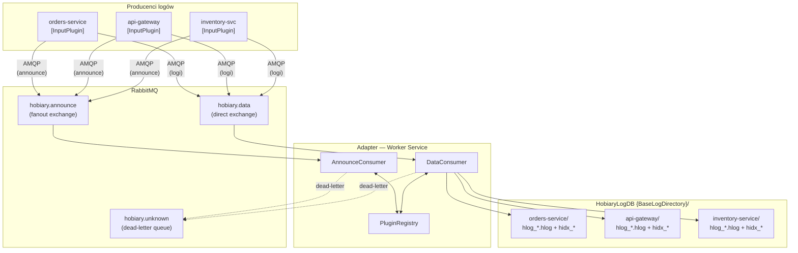

### 1a. Widok ogólny — wariant `Direct`

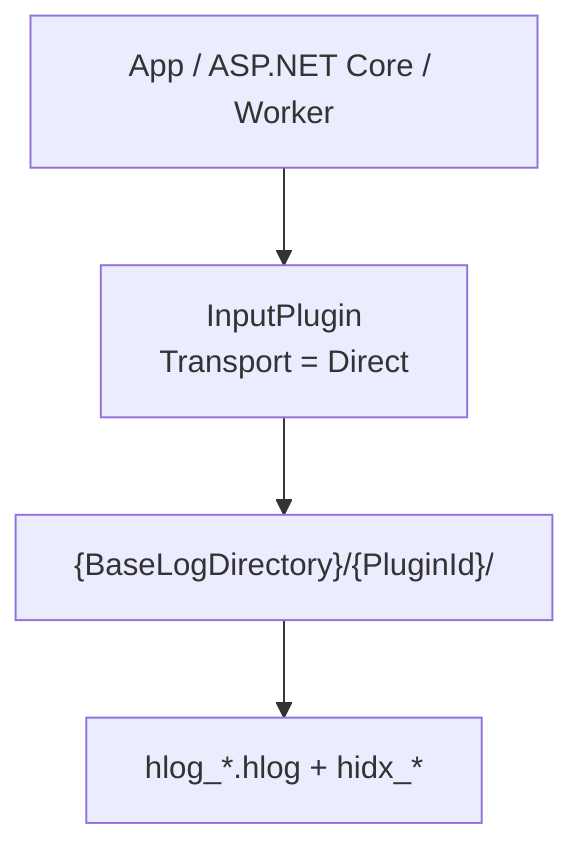

---

## 2. Sekwencja rejestracji pluginu

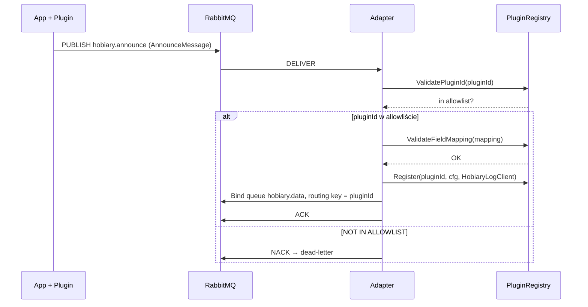

---

## 3. Sekwencja przetwarzania wiadomości danych

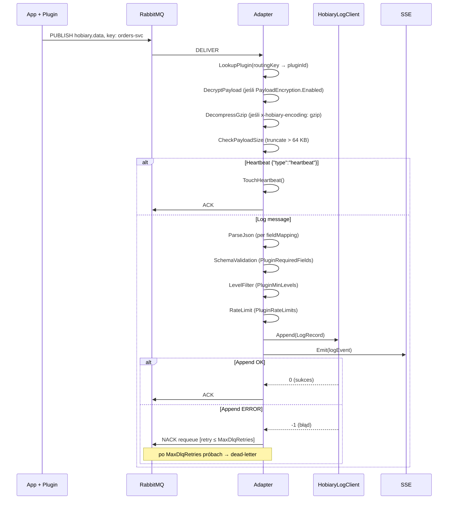

---

## 3a. Sekwencja zapisu w wariancie `Direct`

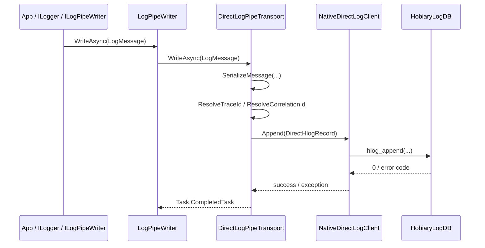

---

## 4. Struktura wewnętrzna Adaptera

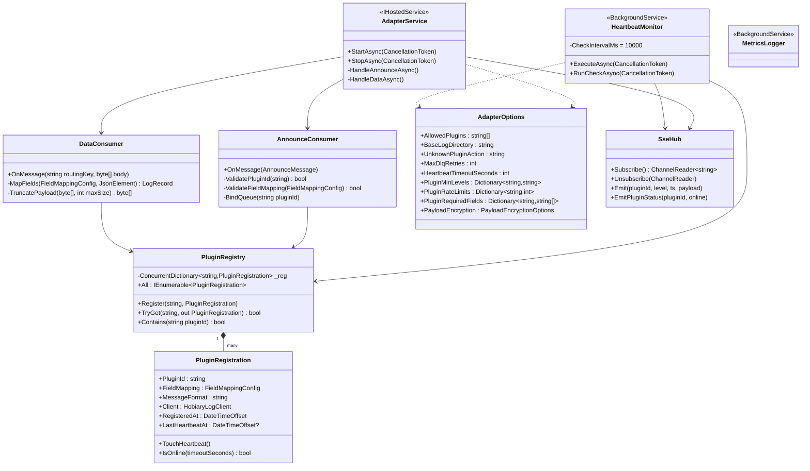

---

## 5. Struktura wewnętrzna InputPlugin

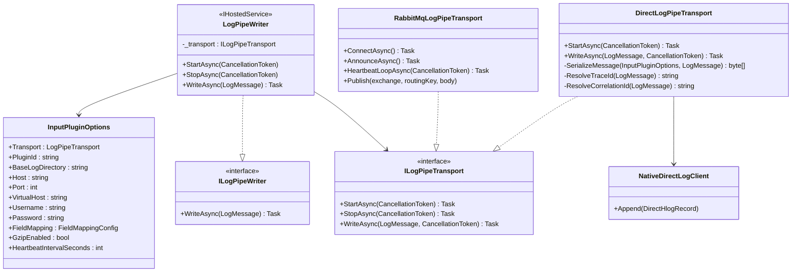

---

## 6. Warstwy zależności projektów

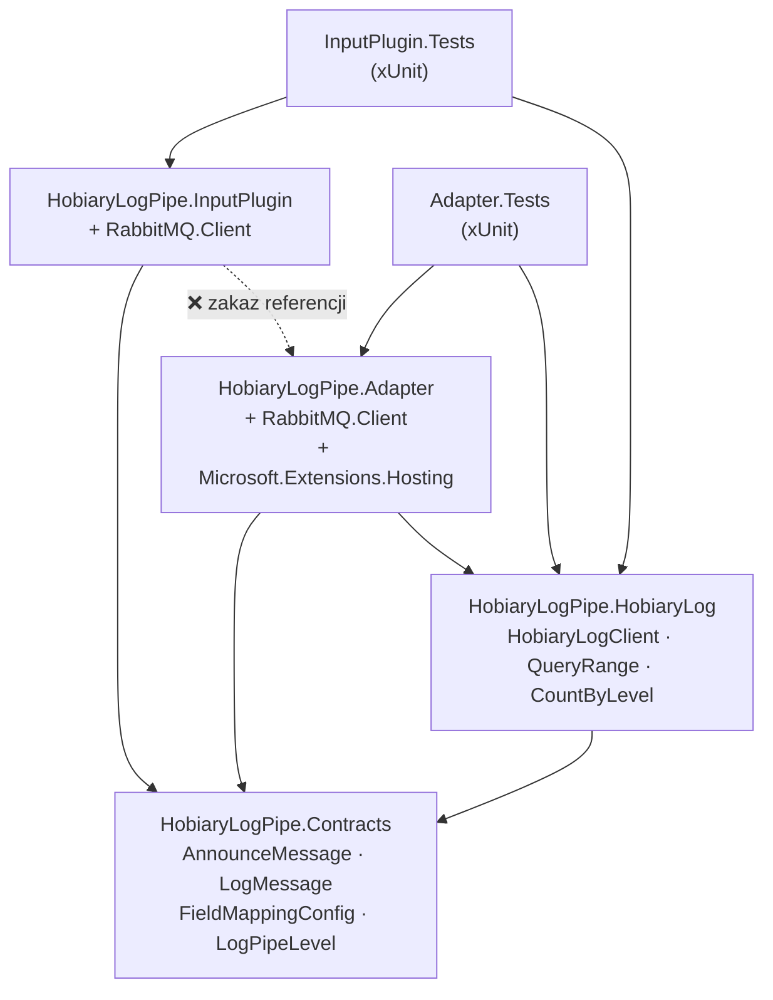

---

## 7. Model bezpieczeństwa

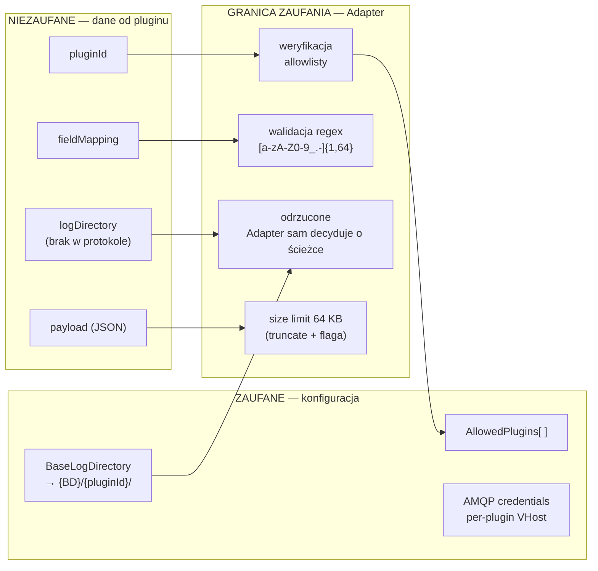

### 7a. Known limitations wariantu `Direct`

Wariant `Direct` jest świadomie uproszczony i ma inny profil ryzyka niż pełny pipeline z Adapterem.

Najważniejsze ograniczenia:

- brak `announce`, więc nie istnieje centralna rejestracja pluginu ani dynamiczne bindowanie po `pluginId`,
- brak `heartbeat`, więc nie ma pojęcia `online/offline` ani przejść stanów znanych z `PluginRegistry`,
- brak `dead-letter`, retry i `MaxDlqRetries`, więc błąd zapisu kończy się lokalnie w procesie producenta,
- brak warstwy `allowlist`, `PluginRequiredFields`, `PluginMinLevels` i `PluginRateLimits`, bo nie ma Adaptera, który mógłby je egzekwować,
- brak centralnego REST API, dashboardu, SSE i live-obserwowalności,
- odpowiedzialność za `BaseLogDirectory` przechodzi na aplikację używającą `InputPlugin`,
- izolacja między pluginami wynika wyłącznie z tego, jaki katalog wybierze proces i jakim `PluginId` się posługuje,
- brokerless path nie amortyzuje chwilowych problemów I/O kolejką RabbitMQ; opóźnienie lub błąd dysku jest widoczny bezpośrednio w aplikacji.

W praktyce `Direct` jest dobry do lokalnych demo, środowisk single-host i prostych wdrożeń embedded, ale nie zastępuje pełnego modelu operatorskiego Adaptera.

### 7b. Różnice bezpieczeństwa i operacyjne: `RabbitMq` vs `Direct`

| Obszar | `RabbitMq` | `Direct` |
|---|---|---|
| Granica zaufania | Wymuszona przez Adapter | Wewnątrz procesu producenta |
| Kontrola `pluginId` | `allowlist` + walidacja regex w Adapterze | Walidacja lokalna w `InputPlugin`, bez centralnej polityki |
| Wybór katalogu logów | Adapter wyznacza `{BaseLogDirectory}/{pluginId}` | Proces sam wskazuje `BaseLogDirectory` |
| Retry / buforowanie | RabbitMQ + NACK + dead-letter | Brak kolejki pośredniej |
| Heartbeat / online status | Tak | Nie |
| Dashboard / API / SSE | Tak | Nie |
| Rate limiting / required fields | Tak, w Adapterze | Nie |
| Blast radius awarii | Błąd producenta może być zamortyzowany przez broker | Problem zapisu uderza bezpośrednio w producenta |

Konsekwencje projektowe:

- `RabbitMq` preferuj tam, gdzie potrzebne są polityki bezpieczeństwa, centralny nadzór, wieloźródłowy ingest i separacja obowiązków między producentem a storage,
- `Direct` preferuj tam, gdzie najważniejsze są prostota wdrożenia, brak brokera i lokalny zapis na tym samym hoście,
- przejście z `Direct` na `RabbitMq` nie zmienia formatu `.hlog`, ale zmienia odpowiedzialność operacyjną: z procesu aplikacji na Adapter + RabbitMQ.

---

## 8. Maszyna stanów PluginRegistration

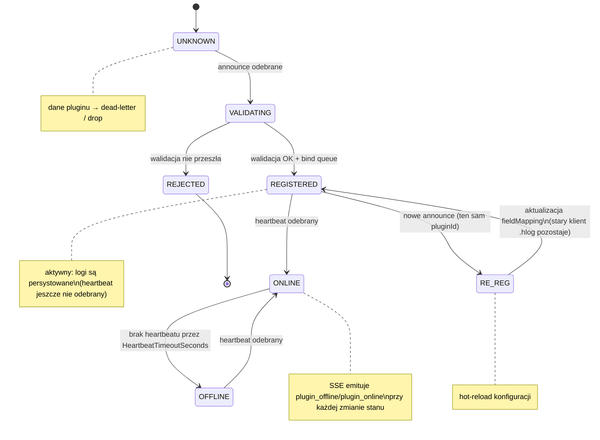

---

## 9. Układ plików na dysku (runtime)

```
{BaseLogDirectory}/
├── orders-service/              ← tworzone przy pierwszej rejestracji
│   ├── hlog_000001.hlog
│   ├── hlog_000001.hidx_time
│   ├── hlog_000001.hidx_error
│   ├── hlog_000001.hidx_level
│   ├── hlog_000001.hidx_src
│   └── hlog_000002.hlog         ← po rotacji (segment > 64 MB)
├── api-gateway/
│   └── hlog_000001.hlog
├── inventory-service/
│   └── hlog_000001.hlog
└── hobiary.unknown/             ← opcjonalny zapis dead-letter
```

---

## 10. Diagram komponentów NuGet / referencji

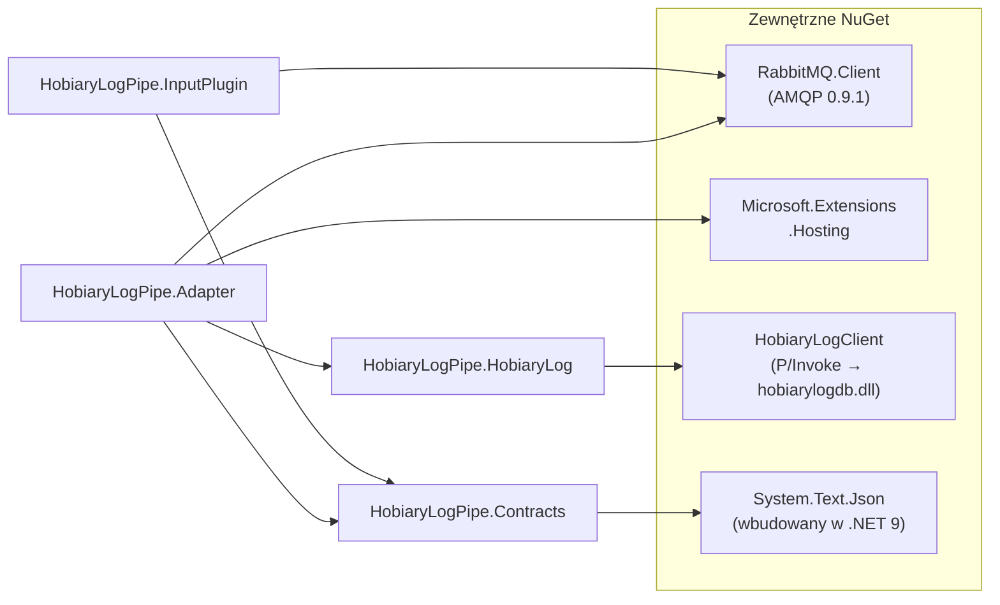

---

## 11. REST API i SSE — endpointy

Adapter eksponuje wbudowany HTTP server (`Microsoft.AspNetCore.Builder.WebApplication`) na porcie `8080` (konfigurowalny przez `ASPNETCORE_URLS`).

### Endpointy

| Metoda | Ścieżka | Opis |
|--------|---------|------|
| `GET` | `/api/plugins` | Lista zarejestrowanych pluginów (pluginId, format, czasy) |
| `GET` | `/api/plugins/{pluginId}` | Szczegóły pluginu: pola, `lastHeartbeatAt`, `isOnline` |
| `GET` | `/api/plugins/{pluginId}/logs` | Odczyt logów z `.hlog` (query: `from`, `to`, `level`, `limit`) |
| `GET` | `/events` | SSE stream: zdarzenia w czasie rzeczywistym |

### SSE — typy zdarzeń

```json
{ "eventType": "log",           "pluginId": "orders-svc", "level": "Error", "timestampUs": 1700000000000000, "payload": "..." }
{ "eventType": "plugin_online", "pluginId": "orders-svc", "timestampUs": 1700000000000000 }
{ "eventType": "plugin_offline","pluginId": "orders-svc", "timestampUs": 1700000000000000 }
```

### Heartbeat flow

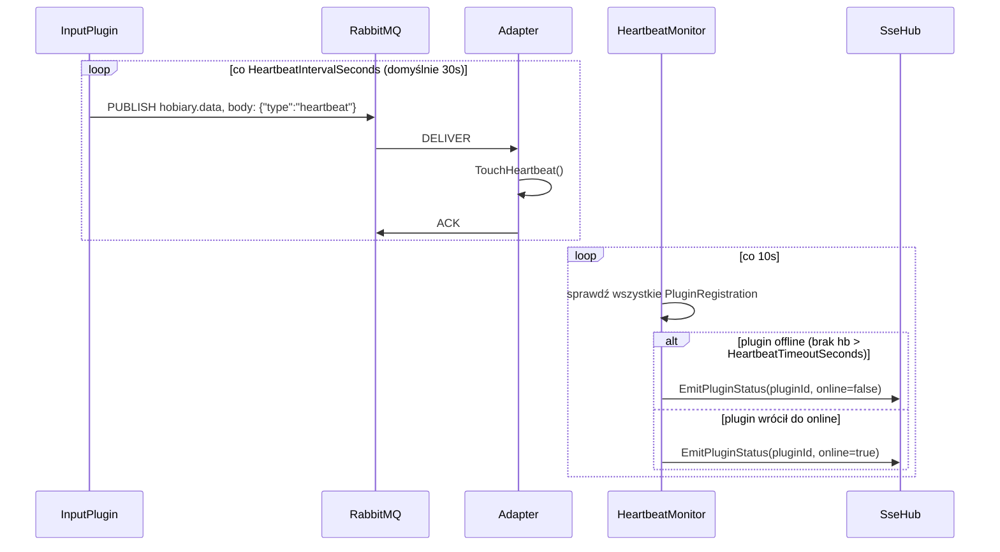

