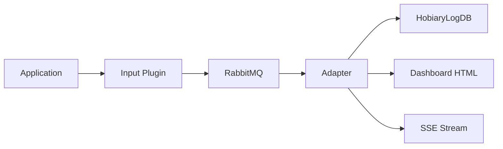

# HobiaryLogPipe Docs

HobiaryLogPipe to pipeline logów oparty o model:



Ta dokumentacja porządkuje istniejące materiały projektu pod `MkDocs`, bez duplikowania źródeł.

!!! note "Dla kogo jest ten zestaw"
	Ta dokumentacja jest ułożona pod trzy ścieżki pracy: szybkie uruchomienie pipeline'u, integrację pluginu oraz diagnostykę działającego Adaptera.

## Co tu znajdziesz

- `Overview` — szybki przegląd projektu, REST API i sposobu uruchamiania.
- `Przewodnik Uzytkownika` — konfiguracja, wdrożenie i praca operacyjna.
- `Dashboard i Operacje` — obsługa dashboardu, live feedu, SSE i podstawowej diagnostyki.
- `Troubleshooting` — typowe awarie i najszybsze ścieżki diagnozy.
- `Deployment Adaptera` — minimalny checklist wdrożeniowy i zależności środowiskowe.
- `Integracja Pluginow` — szybka ścieżka podłączenia aplikacji do pipeline'u.
- `Cookbook` — gotowe scenariusze użycia bez składania całości z kilku stron.
- `Architektura` — opis przepływu danych i decyzji projektowych.
- `Plan rozwoju` — uporządkowana roadmapa vNext i kolejność prac nad brokerless oraz toolingiem.
- `Changelog` — historia zmian.
- `Konfiguracja adaptera` — gotowy przykład `appsettings.example.json`.
- `Release readiness` — scenariusze testowe i kryteria uznania wersji za gotową do wydania.

## Od czego zacząć

Jeśli chcesz przede wszystkim:

- uruchomić projekt lokalnie, zacznij od `Overview` i `Przewodnik Uzytkownika`,
- zintegrować aplikację z pipeline'em, przejdź do `Overview`, potem do `REST API`,
- diagnozować działający system, użyj `Dashboard i Operacje` oraz `REST API`.
- odtworzyć typową awarię lub brak danych, zacznij od `Troubleshooting`.
- wdrożyć Adapter na nowym środowisku, przejdź do `Deployment Adaptera`.
- szybko skopiować gotowy przepis integracyjny, zacznij od `Cookbook`.

## Jak to jest zorganizowane

Przy każdym `mkdocs build` i `mkdocs serve` hook synchronizuje wybrane pliki z katalogu głównego repozytorium do `docs/_generated/`.

Dzięki temu:

- `README.md` pozostaje głównym onboardingiem projektu,
- dokumentacja `MkDocs` pokazuje te same treści w spójnej nawigacji,
- nie trzeba utrzymywać dwóch niezależnych wersji dokumentów.

## Najważniejsze obszary

| Obszar | Po co tam wejść |
|---|---|
| `REST API` | kontrakt endpointów, paginacja, eksport, błędy `v1` |
| `Dashboard i Operacje` | live feed, SSE, szybka diagnostyka i operacyjny workflow |
| `Troubleshooting` | najczęstsze problemy: RabbitMQ, allowlista, API key, brak logów, SSE |
| `Deployment Adaptera` | wymagania środowiskowe, checklist startowy, walidacja po wdrożeniu |
| `Integracja Pluginow` | minimalna konfiguracja producenta logów i ścieżka uruchomienia |
| `Cookbook` | krótkie przepisy na start, diagnostykę i eksport danych |
| `Plan rozwoju` | kolejność prac vNext, zależności etapów i Definition of Done |
| `Konfiguracja adaptera` | gotowy wzorzec `appsettings` do uruchomienia Adaptera |
| `Release readiness` | checklista testów przed wydaniem i kryteria akceptacji |
| `Publikacja dokumentacji` | workflow `GitHub Pages` i lokalna walidacja |
| `Publikacja Self-Hosted` | pakowanie `site/` do artefaktu dla obecnego hostingu |

## Szybki start dokumentacji

```powershell
.\.venv\Scripts\mkdocs.exe build
.\.venv\Scripts\mkdocs.exe serve -a 127.0.0.1:8000
```

Lokalny podgląd: <http://127.0.0.1:8000/>

## Kolejny sensowny krok

Naturalnym rozwinięciem będzie wydzielenie osobnych stron dla:

- cookbooka per framework i per typ pluginu.